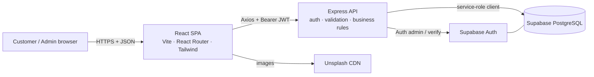
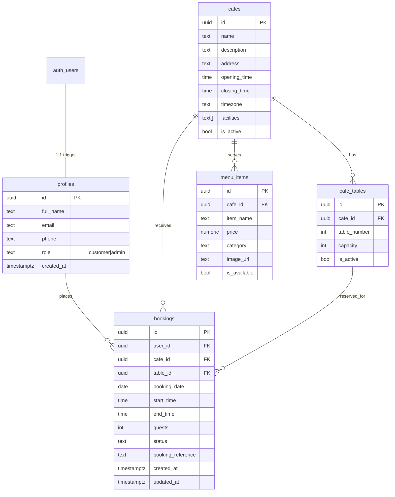
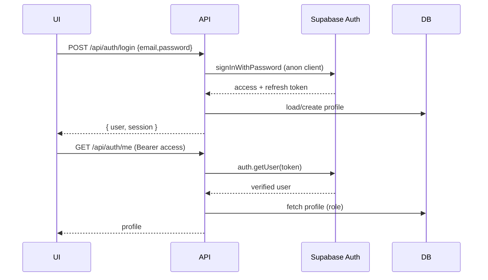

# CafeBook — Architecture

## 1. Overview

CafeBook is a three-tier application:

- **React SPA** (Vite) renders the customer site and the admin console.
- **Express API** owns all business rules, validates input, verifies Supabase
  Auth tokens and talks to PostgreSQL with the service-role client.
- **Supabase** provides Auth, PostgreSQL and Row Level Security.

The frontend never receives the service-role key and never queries Postgres
directly. It only calls the Express API with a Bearer access token.



### Why the service role lives on the server

Supabase RLS alone is not enough for booking integrity: customers should not be
able to insert arbitrary rows into `bookings`. All writes go through Express,
which authenticates the caller and then uses the service-role client. RLS is
still enabled as a second line of defence and for any future direct-client use.

---

## 2. Repository layout

```
frontend/      React application (pages, layouts, components, services, contexts)
backend/       Express API (routes → controllers → services → Supabase)
database/      schema.sql, seed.sql, migrations/
documentation/ Architecture notes and design decisions
```

Layering on the backend:

```
server.js
  └─ routes/*.js            URL + middleware wiring
       └─ controllers/*.js  HTTP request/response only
            └─ services/*.js business logic + SQL/RPC calls
                 └─ config/supabase.js
```

Middleware order for protected routes:
`requireAuth → requireAdmin (admin routes) → validate(zod) → controller`.

---

## 3. Data model



### Key constraints

| Constraint | Purpose |
|------------|---------|
| `bookings_no_overlap` — `EXCLUDE USING gist (table_id WITH =, tsrange(date+start, date+end) WITH &&) WHERE status IN ('pending','confirmed')` | Hard guarantee against overlapping reservations, including concurrent inserts |
| `bookings_active_user_slot_unique` | One active booking per user per cafe/date/start time |
| `bookings.booking_reference UNIQUE` + regex check | Public reference (`CB-XXXXXXXX`) |
| `cafe_tables (cafe_id, table_number) UNIQUE` | Stable table numbering |
| `bookings_time_valid`, `guests BETWEEN 1 AND 20`, capacity check in RPC | Valid time range and party size |
| Foreign keys with cascades/restrict | Referential integrity |

`btree_gist` provides the `uuid =` operator class required by the exclusion
constraint. The constraint is evaluated by PostgreSQL at insert time, so two
simultaneous requests for the same table/slot cannot both succeed — the second
receives a `23P01` (exclusion violation), mapped to HTTP **409**.

---

## 4. Booking flow

### Slots

- Opening 10:00, closing 22:00, timezone `Asia/Kolkata` (per cafe row).
- Seating duration: **90 minutes**.
- Start times every **30 minutes**; last start 20:30.
- All layers use the same slot list generated by `buildTimeSlots()` and the
  same database validation in `create_booking`.

### Request sequence

```mermaid
sequenceDiagram
  autonumber
  actor C as Customer
  participant UI as React booking wizard
  participant API as Express API
  participant DB as PostgreSQL

  C->>UI: date, time, guests
  UI->>API: GET /api/availability?cafeId&date&time&guests
  API->>DB: select overlapping active bookings
  DB-->>API: occupied table ids
  API-->>UI: tables + is_available / capacity_ok
  C->>UI: choose table
  UI->>API: POST /api/bookings {cafeId,tableId,date,time,guests}
  API->>DB: rpc create_booking(...)
  Note over DB: validate hours, past date, capacity,<br/>duplicate; INSERT guarded by<br/>EXCLUDE constraint (transactional)
  alt success
    DB-->>API: booking row (pending, CB-XXXXXXXX)
    API-->>UI: 201 + booking
  else slot taken
    DB-->>API: SQLSTATE CB009 / 23P01
    API-->>UI: 409 "Someone just booked that table"
    UI->>API: refresh availability
  end
```

### Status machine

```
pending ──► confirmed ──► completed
   │             │
   └─────────────┴──────► cancelled
```

- New bookings are `pending`; the customer sees this immediately.
- Admin may `confirm`, `complete` or `cancel`. Completed/cancelled are terminal.
- Customers may cancel `pending`/`confirmed` bookings before the start time.
- `complete_past_bookings()` promotes finished active bookings to `completed`
  before listings/stats are read.
- Cancelled bookings fall outside the partial exclusion predicate, so the slot
  immediately becomes bookable again.

### Double-booking defences (layered)

1. UI disables unavailable tables.
2. Availability endpoint excludes overlapping active bookings.
3. `POST /api/bookings` validates all inputs server-side.
4. `create_booking` re-checks rules inside the transaction.
5. Exclusion constraint rejects concurrent overlap even if checks race.
6. Unique index blocks the same customer double-booking the same slot.

---

## 5. Authentication and authorization



- Registration uses `auth.admin.createUser({ email_confirm: true })` so tables
  can be booked immediately without an SMTP round-trip. The trigger
  `on_auth_user_created` inserts a **customer** profile.
- Access tokens are verified on every protected request. The client refreshes
  via `POST /api/auth/refresh`; the Axios interceptor retries the original call.
- Admin access is enforced by `requireAdmin` reading the **database role**, not
  a client-supplied field.

### RLS summary

| Table | anon / authenticated | Notes |
|-------|----------------------|-------|
| `cafes` | select active | writes only for admins |
| `cafe_tables` | select active | writes only for admins |
| `menu_items` | select all (needed to show sold-out state) | writes only for admins |
| `bookings` | select own; admins select all | no direct insert/update/delete policies → API only |
| `profiles` | select own; update own **name/phone only** via column grants | role is never client-writable |

The database revokes `INSERT/DELETE/UPDATE` on `profiles` from `anon` and
`authenticated`, then re-grants only `UPDATE (full_name, phone)`. This prevents
privilege escalation via PostgREST.

---

## 6. API surface

```
/api
├── auth
│   ├── POST /register          public
│   ├── POST /login             public
│   ├── POST /refresh           public
│   ├── GET  /me                auth
│   ├── PATCH /profile          auth
│   └── POST /logout            auth
├── cafes
│   ├── GET /                   public
│   ├── GET /:id                public
│   └── GET /:id/menu           public
├── tables                      public
├── availability                public
├── bookings
│   ├── POST /                  auth
│   ├── GET /                   auth
│   ├── GET /:id                auth (owner/admin)
│   └── PATCH /:id/cancel       auth (owner)
└── admin                        auth + admin
    ├── GET  /stats
    ├── GET  /bookings
    ├── PATCH /bookings/:id/status
    ├── GET  /customers
    ├── GET/POST /tables
    ├── PUT /tables/:id
    └── GET/POST /menu, PUT/DELETE /menu/:id
```

Validation (Zod) covers UUIDs, dates, time strings, guest bounds, phone/email,
menu category enums, prices and statuses. Errors use a single JSON shape:

```json
{ "message": "Human readable", "errors": { "field": ["Reason"] } }
```

---

## 7. Frontend architecture

### Routes

| Path | Layout | Guard |
|------|--------|-------|
| `/` | Main | public |
| `/cafe` | Main | public |
| `/menu` | Main | public |
| `/login`, `/register` | Main | redirect if signed in |
| `/book` | Main | customer |
| `/bookings` | Main | customer |
| `/profile` | Main | customer |
| `/admin` | Admin | admin |
| `/admin/bookings`, `/admin/tables`, `/admin/menu`, `/admin/customers` | Admin | admin |
| `*` | Main | 404 |

### State and data flow

- `AuthContext` owns the user/session, restores sessions on refresh, exposes
  login/register/logout/updateProfile.
- `ToastContext` renders success/error notifications.
- `services/api.js` is the single Axios instance: attaches the Bearer token,
  refreshes once on 401, and emits logout if refresh fails.
- Page-level `useState`/`useEffect` handles fetching; no global cache is needed
  for this project size.
- Admin writes re-fetch the affected list so the UI matches the database.

### Design system

- Tailwind tokens: cream backgrounds, coffee/espresso text, caramel accent.
- Playfair Display for headings + Inter for body.
- Shared UI primitives (`Button`, `Field`, `Modal`, `StatusBadge`, `SmartImage`,
  `EmptyState`, `StatCard`) keep spacing and interaction consistent.
- Responsive layouts switch from multi-column desktop grids to stacked mobile
  cards; the admin area has a drawer sidebar under `lg`.

---

## 8. Environment variables

### backend/.env

| Variable | Required | Purpose |
|----------|----------|---------|
| `PORT` | no (5000) | API port |
| `NODE_ENV` | no | development/production |
| `CLIENT_ORIGIN` | yes | Comma-separated CORS allow-list |
| `SUPABASE_URL` | yes | Project URL |
| `SUPABASE_ANON_KEY` | yes | Password sign-in / refresh |
| `SUPABASE_SERVICE_ROLE_KEY` | yes | DB + Auth admin (server only) |
| `ADMIN_EMAIL/PASSWORD/NAME` | for seeding | Admin account |

### frontend/.env

| Variable | Purpose |
|----------|---------|
| `VITE_API_URL` | Base URL of the Express API (default `http://localhost:5000/api`) |

---

## 9. Local verification plan (Phase 5)

1. Run schema + seed in Supabase, then `npm run seed:admin`.
2. `GET /api/health` → Supabase configured.
3. Customer: register → book → see reference → cancel.
4. Second customer: attempt the same table/slot → 409 and refreshed list.
5. Admin: confirm/complete/cancel; table and menu CRUD; verify public pages.
6. Customer attempts `/admin` → redirected; direct API call → 403.
7. Insert two overlapping bookings via SQL/Postman concurrently and confirm one
   fails with an exclusion violation.

---

## 10. Future deployment (not started)

- **Frontend → Vercel:** set `VITE_API_URL` to the Render API URL; add the
  Vercel domain to backend `CLIENT_ORIGIN`.
- **Backend → Render:** Node web service, build `npm install`, start
  `npm start`, set the Supabase keys and `CLIENT_ORIGIN`.
- **Supabase:** production project uses the same schema; configure Auth redirect
  URLs. `service_role` stays only in Render environment variables.
- **Testing:** Selenium/Mocha for UI flows, Postman/Newman for API and
  concurrency cases, HTML reports and defect logs.

---

## 11. Assumptions and constraints

- One active cafe is seeded; the schema already supports multiple cafes.
- Rupee pricing and the `Asia/Kolkata` timezone are seeded defaults.
- Tables hold up to 8 guests; the DB allows up to 20 for future larger tables.
- Images use Unsplash URLs; `SmartImage` falls back to a cafe photo if a URL
  fails.
- Email delivery is not configured; registration auto-confirms accounts for the
  college demo. In production, enable Supabase email confirmation and adjust
  the register flow if desired.
